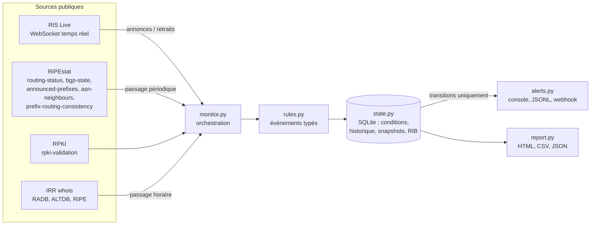

# BGP Monitor — enquête sur le hijack visant Orange France

<p align="center">
  
  
  
  
  
</p>

`bgpmon` est un moniteur BGP **100 % passif et défensif**. Il a été écrit pendant une enquête OSINT sur un hijack BGP visant de l'espace IPv4 d'Orange France (AS3215). Il n'utilise que des sources publiques en lecture : le flux temps réel **RIS Live**, l'API **RIPEstat**, la validation **RPKI** exposée par RIPEstat et des requêtes **whois IRR** (RADB, ALTDB, RIPE). Il ne fait aucun scan actif.

Rapport d'enquête associé : [bgp-hijack-orange-2026](https://github.com/loic31000/bgp-hijack-orange-2026).

> La version 3 remplace le script `bgp_monitor.py` v2.4, conservé dans [`legacy/`](legacy/) pour référence. Les changements sont détaillés dans [CHANGELOG.md](CHANGELOG.md).

## État de l'incident documenté

- De février à avril 2026, `90.98.0.0/15` a été annoncé avec l'origine AS41128 (ORANGEFR-GRX-AS), par des chemins incohérents du type `… AS29802 → AS22541 → AS41128`.
- Le 20 avril 2026 à 15:01 UTC, AS3215 commence à annoncer les plus-spécifiques `90.98.0.0/16` et `90.99.0.0/16`.
- Le 21 avril 2026 à 17:27 UTC, la route `90.98.0.0/15` via AS41128 est retirée du DFZ.

Un état `ALERTE` du moniteur est une **détection par règles**. Il ne vaut pas attribution de l'acteur responsable.

## Fonctionnement



- **`run`** : deux fils d'exécution alimentent une file unique. Le premier reçoit RIS Live (annonces et retraits en temps réel), le second fait les passages périodiques RIPEstat, RPKI et IRR. Un seul fil écrit dans SQLite.
- **Conditions et transitions** : un problème observé (une origine interdite, par exemple) est une *condition*. L'alerte part quand elle apparaît, puis quand elle est résolue, et jamais à chaque cycle. Une condition peut être confirmée par plusieurs sources (`ripestat`, `ris_live`). Elle n'est résolue que lorsque plus aucune source ne l'observe.
- **Changements ponctuels** (nouveau préfixe, nouvel objet IRR…) : ils sont enregistrés une fois et influencent l'état de la cible pendant `recent_window_hours`.
- **Une erreur de source n'est jamais un « tout va bien »**. Une erreur ne résout aucune condition, et une cible sans donnée ou dont la source RIPEstat échoue est `INCONNU`.

Arborescence :

```text
bgpmon/
├── cli.py              # python -m bgpmon <commande>
├── config.py           # schéma, validation, migration v2.4
├── models.py           # événements, routes, utilitaires AS path
├── monitor.py          # collecte → règles → état → alertes
├── rules.py            # règles de détection (fonctions pures)
├── state.py            # persistance SQLite et transitions
├── alerts.py           # canaux d'alerte, déduplication, cooldown
├── report.py           # rapport HTML, exports CSV/JSON
└── sources/
    ├── ris_live.py     # client WebSocket RIS Live
    ├── ripestat.py     # client HTTP RIPEstat
    └── irr.py          # whois IRR en lecture seule
```

## Installation

Python 3.10 ou plus récent.

```bash
git clone https://github.com/loic31000/bgp-monitor-orange-hijack.git
cd bgp-monitor-orange-hijack
python -m venv .venv
source .venv/bin/activate          # Windows PowerShell : .\.venv\Scripts\Activate.ps1
pip install -r requirements.txt    # développement : pip install -r requirements-dev.txt
cp config.example.yaml config.yaml # config.yaml est ignoré par git
python -m bgpmon check-config
```

Les dépendances d'exécution sont `requests`, `websocket-client` et `PyYAML`, toutes épinglées.

## Configuration

Le fichier `config.yaml` (YAML ou JSON) est **la seule source de vérité** : aucune cible n'est codée en dur. [`config.example.yaml`](config.example.yaml) reprend les cibles de la v2.4 et documente chaque réglage. Les sous-préfixes `167.32.x` (/21 et /24) n'y sont plus des cibles séparées : la cible `167.32.0.0/16` les couvre (`moreSpecific` sur RIS Live, `more_specifics` sur RIPEstat). La validation est stricte : une clé inconnue, un préfixe mal formé ou un ASN à la fois attendu et interdit bloquent le démarrage, et toutes les erreurs sont listées d'un coup.

### Cible de type préfixe

```yaml
- label: "90.98.0.0/15"
  type: prefix
  resource: "90.98.0.0/15"
  role: "Espace Orange France"
  expected_origins: [3215]            # origines légitimes du préfixe exact
  forbidden_origins: [41128]          # origines interdites (exact, plus- et moins-spécifiques)
  forbidden_path_asns: [41128, 22541, 29802]
  expected_upstreams: []              # vide : l'historique appris sert de référence
  max_prefix_length: 24               # alerte si un plus-spécifique plus fin apparaît
  allow_more_specific_from: [3215]    # vide : expected_origins
  rpki: expect_valid                  # expect_valid | any
  irr: watch                          # watch | ignore
  severity: critical                  # info | warning | high | critical
```

### Cible de type ASN

```yaml
- label: "AS41128"
  type: asn
  resource: 41128
  watch_prefix_set: true    # diff des préfixes annoncés
  watch_neighbours: true    # diff des voisins (asn-neighbours)
  ris_live_origin: true     # abonnement RIS Live "41128$" : toute nouvelle annonce originée
  irr: watch                # aut-num et objets route d'origine AS41128
  severity: high
```

`ris_live_origin` est à réserver aux ASN discrets. Pour un grand opérateur comme AS3215, il générerait un flux continu.

### Préfixe censé rester silencieux

Pour une route retirée qui ne doit pas revenir, comme les trois /24 du pool MCI/SAE :

```yaml
- label: "198.193.12.0/24"
  type: prefix
  resource: "198.193.12.0/24"
  expect_silent: true       # silence attendu
  forbidden_origins: [2702]
  severity: high
```

Tant qu'aucune route n'est observée et que RIPEstat répond, la cible est `OK` (« OK-silencieux »), au lieu d'`INCONNU`. `once` ne renvoie donc pas le code 3 pour elle. Dès qu'une annonce du préfixe ou d'un plus-spécifique réapparaît, quelle que soit l'origine, `SILENCE_BROKEN` est levé. Avec RIS Live, c'est en temps réel. `expect_silent` est incompatible avec `expected_origins` et `allow_more_specific_from`.

### Valeurs par défaut

Un champ omis prend la valeur indiquée dans `config.example.yaml`. Côté cible, les valeurs par défaut sont `severity: high`, `irr: ignore` et `rpki: any`, et toutes les listes sont vides.

### Webhook et secrets

L'URL du webhook n'est jamais écrite dans le dépôt. Elle est lue dans une variable d'environnement :

```bash
export BGPMON_WEBHOOK_URL="https://ntfy.sh/mon-sujet-prive"
```

Le format est détecté d'après l'URL (`discord.com/api/webhooks`, `hooks.slack.com`, `ntfy`), sinon c'est un JSON générique. On peut aussi le forcer avec `format: discord|slack|ntfy|generic`. Une clé `url:` en clair est acceptée, avec un avertissement au démarrage. Elle ne doit figurer que dans un fichier local ignoré par git (`config.yaml`, `config.local.*`).

### Tester réellement le webhook

`bgpmon test-alert` envoie une alerte factice sur les canaux configurés. Elle ignore le cooldown et n'écrit rien dans l'historique. La commande indique le résultat de chaque canal et renvoie 1 si un envoi échoue ou si aucun canal n'est actif.

```bash
# Linux/macOS
export BGPMON_WEBHOOK_URL="https://ntfy.sh/mon-sujet-prive"   # ou URL Discord/Slack
python -m bgpmon check-config            # doit afficher « Canal webhook (auto) : URL présente »
python -m bgpmon test-alert --channel webhook
python -m bgpmon test-alert --channel webhook --severity warning   # vérifie le filtre min_severity
unset BGPMON_WEBHOOK_URL
```

```powershell
# Windows PowerShell
$env:BGPMON_WEBHOOK_URL = "https://ntfy.sh/mon-sujet-prive"
python -m bgpmon test-alert --channel webhook
Remove-Item Env:BGPMON_WEBHOOK_URL
```

Le message reçu commence par `[CRITIQUE] TEST_ALERT — test : Alerte de test envoyée par…` et se termine par « aucune action requise ». Il utilise uniquement des ressources de documentation (192.0.2.0/24, AS64496). Le canal webhook a `min_severity: high` dans la configuration d'exemple : avec `--severity warning`, l'envoi est ignoré, ce qui permet de vérifier le filtre. En cas d'échec, seul le code HTTP est affiché, jamais l'URL. Sans la variable, la commande échoue avec « Aucun canal actif de type webhook ».

### Migration depuis la v2.4

```bash
python -m bgpmon migrate-config legacy/config.v2.json -o config.yaml
python -m bgpmon migrate-config legacy/bgp_monitor.py -o config.yaml --force   # DEFAULT_CONFIG v2.4
```

Le script v2.4 est lu par analyse syntaxique (AST), **sans être exécuté**. La correspondance est la suivante : `legit_asn` devient `expected_origins` et `allow_more_specific_from`, `hijack_asn` devient `forbidden_origins` et `forbidden_path_asns`, `desc` devient `description`. Un `webhook_url` n'est pas recopié : un avertissement invite à utiliser `BGPMON_WEBHOOK_URL`.

## Règles de détection

Chaque événement porte `type`, `severity`, `target`, `prefix`, `origin`, `as_path`, `peer`, `source`, `timestamp` et `evidence` (peers concernés, collecteurs, échantillons de chemins, données brutes utiles à l'enquête).

| Type | Nature | Sévérité | Déclenchement |
|---|---|---|---|
| `ORIGIN_UNEXPECTED` | condition | cible | Préfixe exact annoncé par une origine absente de `expected_origins` (et non interdite). |
| `ORIGIN_FORBIDDEN` | condition | cible | Origine dans `forbidden_origins`, sur le préfixe exact, un plus-spécifique ou un moins-spécifique couvrant. |
| `MORE_SPECIFIC_UNEXPECTED` | condition | cible | Plus-spécifique annoncé par une origine non autorisée, ou plus fin que `max_prefix_length`. |
| `PATH_FORBIDDEN_ASN` | condition | cible | Un ASN de `forbidden_path_asns` apparaît dans l'AS path. L'origine interdite n'est pas comptée deux fois. |
| `PATH_UPSTREAM_CHANGE` | condition / ponctuel | warning | Upstream (ASN adjacent à une origine attendue) absent de `expected_upstreams` (condition), ou jamais observé dans l'historique appris (ponctuel). |
| `PATH_SUSPICIOUS` | condition / ponctuel | warning | Boucle (ASN répété de façon non consécutive, prepending exclu), ASN réservé ou privé dans le chemin (RFC 5398, 6793, 6996, 7300, 7607), origine en AS_SET, ou dernier saut jamais vu pour une origine déjà connue (ponctuel). |
| `VISIBILITY_DROP` / `VISIBILITY_RESTORED` | condition / résolution | warning / info | Peers RIS voyant le préfixe sous `référence × (1 − visibility_drop_pct %)`. |
| `RPKI_INVALID` | condition | cible | Couple (préfixe, origine) observé et `invalid*` (avec `rpki: expect_valid`). |
| `RPKI_UNKNOWN` | condition | warning | Aucun ROA ne couvre le couple observé (avec `rpki: expect_valid`). |
| `RPKI_STATE_CHANGED` | ponctuel | warning | Changement de statut, ROA apparu ou disparu pour un couple déjà observé. |
| `IRR_OBJECT_CREATED` | ponctuel | cible ou info | Nouvel objet `route`/`route6`/`aut-num`. Sévérité de la cible si l'origine n'est pas attendue. |
| `IRR_OBJECT_MODIFIED` / `IRR_OBJECT_DELETED` | ponctuel | warning | Empreinte modifiée (avec la liste des attributs changés) ou objet disparu. |
| `ASN_NEW_PREFIX` / `ASN_PREFIX_GONE` | ponctuel | cible / info | Diff des préfixes annoncés (RIPEstat, et RIS Live si `ris_live_origin`). |
| `ASN_NEW_NEIGHBOUR` / `ASN_NEIGHBOUR_GONE` | ponctuel | cible si amont, sinon warning / info | Diff des voisins `asn-neighbours` des types `settings.ripestat.neighbour_types` (`left`, `right` par défaut ; `uncertain` fluctue beaucoup). |
| `SILENCE_BROKEN` | condition | cible | Cible `expect_silent` : le préfixe ou un plus-spécifique est de nouveau annoncé, quelle que soit l'origine. |
| `SOURCE_ERROR` | condition | warning | Source injoignable depuis `source_error_cycles` passages consécutifs (RIS Live : déconnexions consécutives). |

La sévérité de chaque type peut être surchargée par `settings.severity_overrides`. Au-delà de 10 éléments, une variation de préfixes ou de voisins produit un seul événement groupé.

Le **premier passage** sur une cible sert de référence : aucun diff (préfixes, voisins, IRR, RPKI, upstreams appris) n'est signalé tant que cette référence n'existe pas.

### État d'une cible

| État | Règle |
|---|---|
| `ALERTE` | Une condition active, ou un changement ponctuel récent, de sévérité `high` ou `critical`. Prioritaire même si une autre source est en erreur. |
| `INCONNU` | Le dernier appel RIPEstat de la cible a échoué, ou aucune route n'a jamais été observée (hors `expect_silent`). Jamais `OK` par défaut. |
| `AVERTISSEMENT` | Une condition ou un changement récent de sévérité `warning` (y compris une source secondaire en erreur : RPKI, IRR). |
| `OK` | Données présentes et aucune anomalie, ou cible `expect_silent` sans annonce (« OK-silencieux ») dont la source RIPEstat répond. |

## Utilisation

```bash
# Surveillance continue : RIS Live + passages RIPEstat/RPKI (check_interval) + IRR (irr.interval)
python -m bgpmon run
python -m bgpmon run --duration 120 --no-irr        # test de 2 minutes

# Un seul passage (CI, cron) : code 0 si OK/avertissement, 2 si alerte, 3 si état inconnu
python -m bgpmon once
python -m bgpmon once --no-irr --allow-unknown

# Rapport HTML et exports
python -m bgpmon report --csv events.csv --json events.json

# Événements filtrés
python -m bgpmon events --severity high --since 2026-10-01
python -m bgpmon events --target 90.98.0.0/15 --type ORIGIN_FORBIDDEN --format csv -o events.csv

# Configuration
python -m bgpmon check-config -c config.yaml
python -m bgpmon migrate-config legacy/config.v2.json -o config.yaml

# Alerte factice sur les canaux configurés (voir « Tester réellement le webhook »)
python -m bgpmon test-alert --channel webhook
```

Le fichier de configuration est choisi avec `-c`, sinon `$BGPMON_CONFIG`, sinon `config.yaml`. `--log-level` surcharge `settings.log_level`, et `log_format: json` écrit une ligne JSON par entrée de journal.

`SIGINT` et `SIGTERM` déclenchent un arrêt propre : la connexion RIS Live est fermée, les éléments en file sont traités, puis le rapport est écrit et SQLite fermé.

### Fichiers produits

| Fichier | Contenu |
|---|---|
| `bgpmon.sqlite3` | État courant, conditions, historique des événements, snapshots (préfixes, voisins, IRR, RPKI, visibilité), RIB RIS Live. |
| `bgp_report.html` | Rapport autonome (thème sombre) : cibles, sources en erreur, chronologie des 50 derniers événements, historique par cible. Rafraîchissement = `report.refresh_seconds` ou `check_interval`. |
| `bgp_alerts.jsonl` | Une ligne JSON par alerte envoyée. |
| `bgpmon.log` | Journal applicatif. |

Tous ces fichiers sont ignorés par git.

### Docker et systemd

```bash
docker build -t bgpmon .
mkdir -p data && cp config.example.yaml data/config.yaml
docker run --rm -v "$PWD/data:/data" -e BGPMON_WEBHOOK_URL bgpmon            # run
docker run --rm -v "$PWD/data:/data" bgpmon once --no-irr                     # un passage
```

Un exemple d'unité durcie est fourni dans [`deploy/bgpmon.service`](deploy/bgpmon.service).

## Développement

```bash
pip install -r requirements-dev.txt
ruff check bgpmon tests && ruff format --check bgpmon tests
mypy bgpmon tests
python -m pytest
```

Les tests n'accèdent jamais au réseau : un mécanisme bloque les sockets, et les sources sont simulées par des messages RIS Live et des réponses RIPEstat ou whois dans `tests/fixtures/`. La CI GitHub Actions lance le lint, le typage et les tests sur Python 3.10, 3.12 et 3.13.

## Limites connues

- **Délai RIPEstat** : `routing-status` est agrégé à la journée et ignore les routes vues par moins de 10 peers RIS. `bgp-state` peut avoir plusieurs heures de retard. Un nouveau plus-spécifique peut donc n'apparaître dans le passage périodique qu'avec retard. RIS Live le voit en temps réel, à condition que le moniteur tourne.
- **`bgp-state` ne couvre que le préfixe exact** : les plus- et moins-spécifiques sont découverts via `routing-status`, puis détaillés jusqu'à `max_more_specific_queries` préfixes. Au-delà, seule leur origine est connue.
- **RIB RIS Live partielle** : au démarrage, RIS Live ne fournit pas de table complète. La RIB locale ne contient que les routes ayant changé depuis la mise en service (elle est persistée dans SQLite). Les sessions de peers tombées sans retrait explicite ne sont pas purgées.
- **Couverture des collecteurs RIS** : un hijack très localisé, invisible des peers RIS, n'est pas détecté.
- **`announced-prefixes`** travaille sur une fenêtre (`asn_prefix_window_hours`, 24 h par défaut) : la disparition d'un préfixe est signalée avec ce retard.
- **IRR** : l'ancien nom `rr.altdb.net` ne résout plus. ALTDB est interrogé sur `whois.altdb.net`. Pour éviter de stocker des données personnelles, seuls des attributs non personnels sont conservés (`route`, `origin`, `mnt-by`, `source`, `last-modified`…). Les autres (`descr`, `changed`, `notify`…) ne sont gardés que sous forme d'empreinte. Les serveurs whois peuvent limiter le débit.
- **Faux positifs possibles** : plus-spécifiques légitimes d'un client ou d'un CDN (par exemple `90.98.0.0/18` annoncé par AS54113, à qualifier puis à ajouter à `allow_more_specific_from`), changements d'upstream normaux, ASN privés retirés tardivement, absence de ROA (`RPKI_UNKNOWN`) fréquente pour l'espace ancien. Ajustez `severity_overrides` et `cooldown_seconds`.
- La validation RPKI est celle calculée par RIPEstat (validateur Routinator) et non par un validateur local.

## Licence

Projet sous licence MIT, voir [LICENSE](LICENSE).
